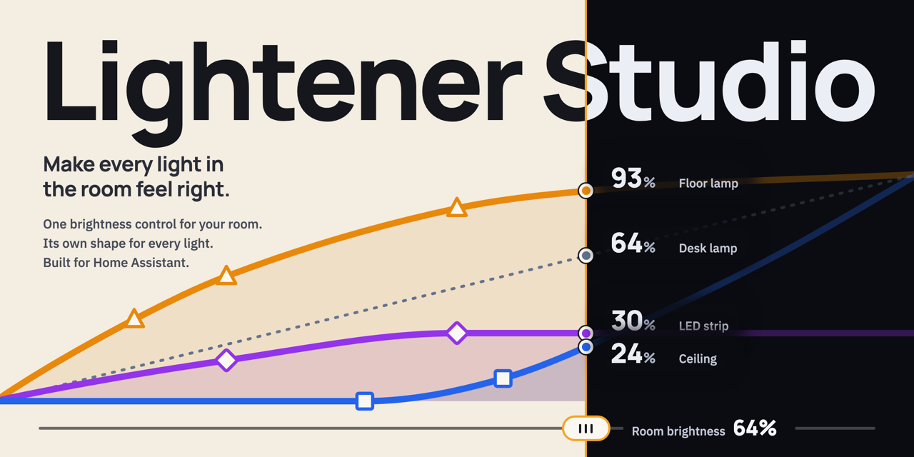
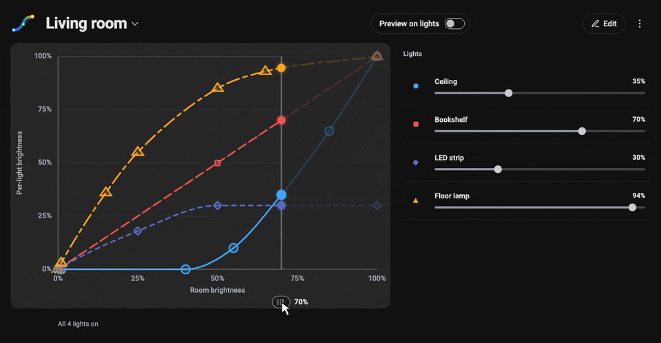
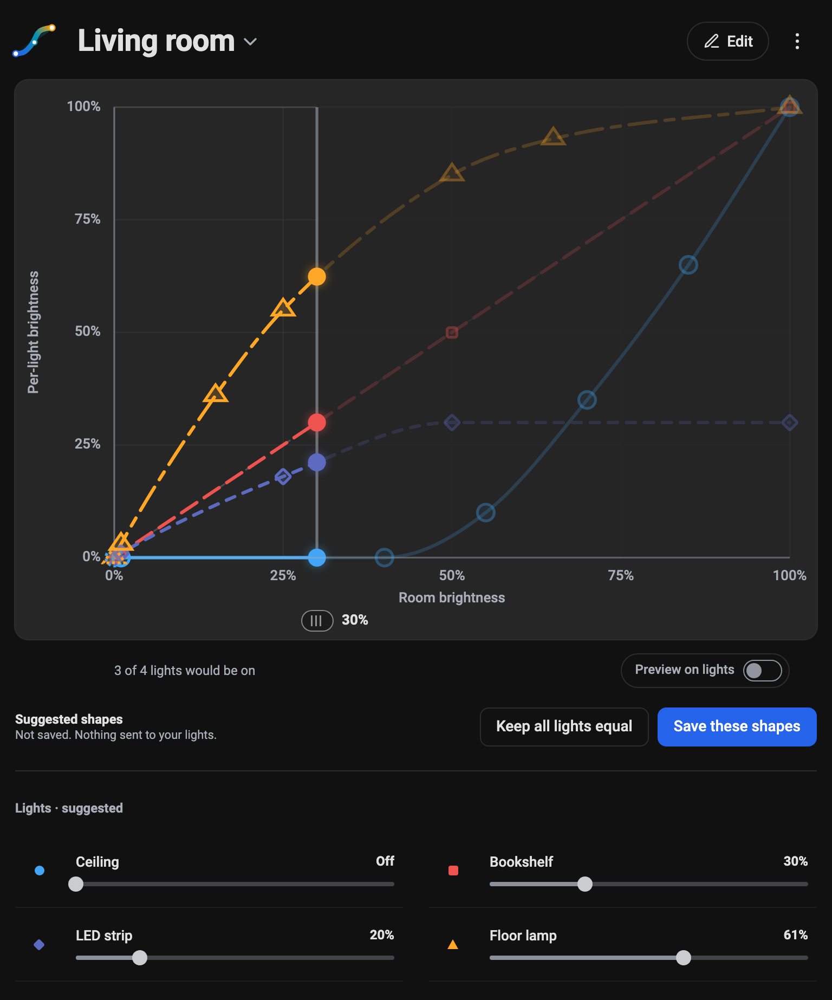
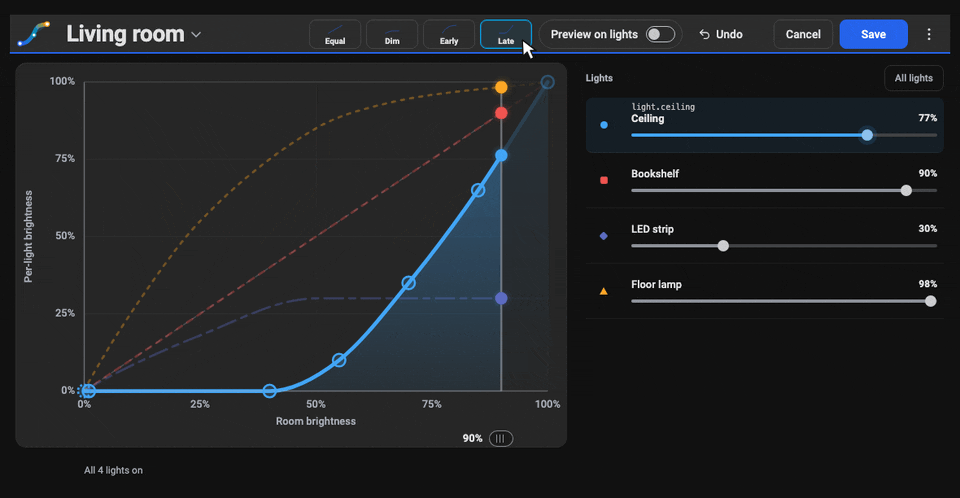
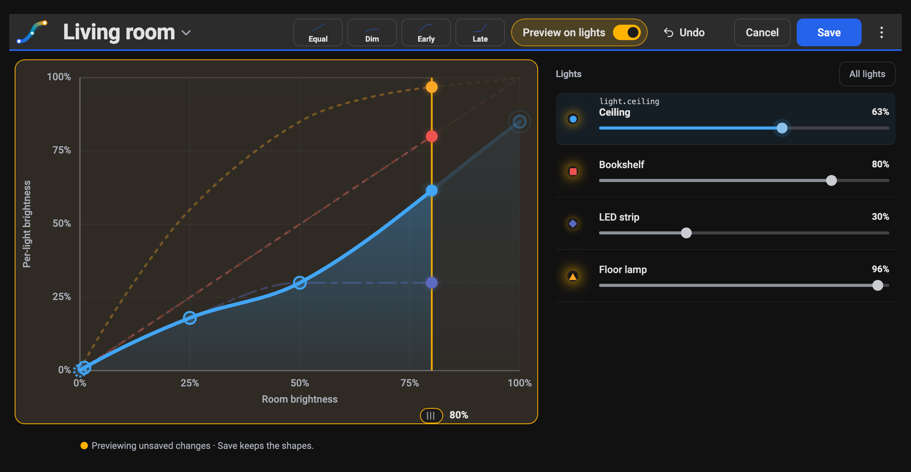

  

Lightener Studio dims a whole room with one brightness control, while each light follows its own shape.

  

Each line is one light's shape. Here the ceiling light stays off while the room is dim, and the LED strip never goes above 30%.

  
  &nbsp;
  

  More to play with: <a href="https://florianhorner.github.io/lightener-studio/joy.html">how the editor moves</a> · <a href="https://florianhorner.github.io/lightener-studio/color-temp-demo.html">color temperature, an exploration</a>

## What it does

**Start from suggested shapes.** A new group can open with a shape for each light, guessed from its name.

  

**Give each light its own shape.** Drag its points to keep a bright lamp soft, or to bring one light up before another.

  

**Try it in your room before you save.** With **Preview on lights** on, your real lights follow Room brightness.

  

**The group is one more light in Home Assistant.** Dashboards and automations dim it like any other. No YAML or dashboard card needed.

**Readable without color.** Line patterns and markers tell the lights apart. Keyboard and touch work too.

## Installing

Requires Home Assistant 2024.8.0 or newer. From Home Assistant 2026.11 you install it from the built-in Marketplace; older versions need [HACS](https://www.hacs.xyz/docs/use/). Start with two dimmable lights. Removing Lightener Studio later removes the groups it created; your lights stay as they are.

### Find and download Lightener Studio

1. Open **Settings → Marketplace** and find **Lightener Studio**, or use the button above. The original **Lightener** from `fredck/lightener` is a separate listing.
2. Choose **Install**, check the version, and choose **Install** again. Setup opens right after. If Home Assistant asks for a restart first, let it restart.

On Home Assistant 2026.10 or older, use HACS instead: open **Lightener Studio** there, choose **Download**, then restart Home Assistant.

Not listed? In the Marketplace choose **Add from link** and enter `florianhorner/lightener-studio`. In HACS, open the three-dot menu → **Custom repositories**, add `https://github.com/florianhorner/lightener-studio` as an **Integration**, then download it and restart Home Assistant. [More on a missing listing](https://github.com/florianhorner/lightener-studio/blob/master/docs/TROUBLESHOOTING.md#lightener-studio-is-missing-from-the-marketplace).

### Configure your first group

1. If setup did not open by itself, open **Settings → Devices & Services → Add Integration** and choose **Lightener Studio**, or [open the setup directly](https://my.home-assistant.io/redirect/config_flow/?domain=lightener_studio).
2. Name the group, for example **Living room**, then choose the lights that should dim together.
3. The last dialog's details are optional; finish with **Finish** or **Skip and finish**. Setup adds one new light named after the group. Use that light on dashboards and in automations; your single lights stay as they are.
4. Open **Lightener Studio** in the sidebar (`/lightener-editor`). You can also choose **Visit** on the group's device page, or **Configure** beside the group on the Lightener Studio integration page.

### Save your first shape

**Fastest:** if the editor opens with suggested shapes, choose **Save these shapes**. Nothing is saved or sent to your lights before you do.

**Or shape one light yourself.** If suggested shapes show, choose **Keep all lights equal** first; every light then follows the group's brightness.

1. Select a light under **Lights**, then choose **Dim**. Above half room brightness, that light stays at about 30%. Drag the points on its line to adjust.
2. Optional: turn on **Preview on lights** and move **Room brightness** to see the change on your real lights. Reloading or closing the page during a preview can leave the lights at the preview brightness.
3. Choose **Save** and wait for **Saved** in its place.

Either way, dim the new light like any other from now on. Each light follows its saved shape.

**Show me how** in the editor's **⋮** menu plays a short example on your own graph. It saves nothing and changes no light.

**Help:** [Guide](https://github.com/florianhorner/lightener-studio/blob/master/docs/GUIDE.md) (the editor, dashboard card, updating, removing) · [Troubleshooting](https://github.com/florianhorner/lightener-studio/blob/master/docs/TROUBLESHOOTING.md) · [Tell us what your lights did](https://github.com/florianhorner/lightener-studio/blob/master/docs/OPEN-ROOM-LAB.md) · [Changelog](https://github.com/florianhorner/lightener-studio/blob/master/CHANGELOG.md)

**For developers:** [WebSocket API](https://github.com/florianhorner/lightener-studio/blob/master/docs/API.md) · [Contributing](https://github.com/florianhorner/lightener-studio/blob/master/CONTRIBUTING.md) · [Security](https://github.com/florianhorner/lightener-studio/blob/master/SECURITY.md) · [License](https://github.com/florianhorner/lightener-studio/blob/master/LICENSE)

> Built on the [Lightener](https://github.com/fredck/lightener) integration by @fredck, extended for the visual editor (the WebSocket commands the card needs, plus config-flow and state-handling hardening). Upstream MIT license intact.
